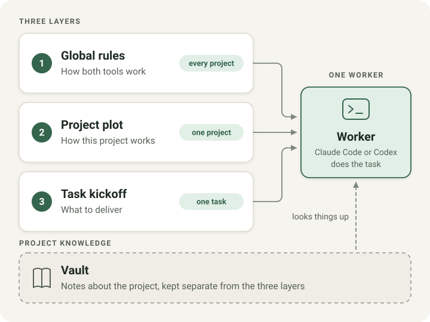
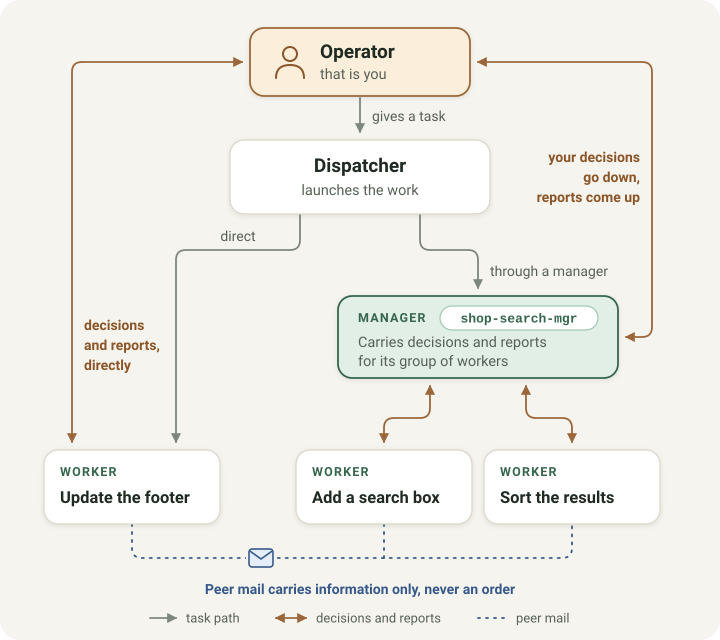

<div align="center">


# Slopmeister

*Plant a task. Inspect the harvest.*

Slopmeister is a **development framework where coding agents earn their merge.**

[](https://github.com/Ellebam/slop-meister/actions/workflows/check.yml)
[](https://github.com/Ellebam/slop-meister/releases)
[](LICENSE)

[Quick start](#quick-start) · [Walkthrough](docs/session-walkthrough.md) · [Documentation](docs/README.md) · [Examples](#add-your-own-plot)

</div>

Slopmeister helps you run a coding task with Claude Code and Codex. One tool builds the change in its own Git worktree. The other checks the plan and tests the result. You choose the direction before implementation and decide when the work is ready to merge.

Suppose you want a search box for a shop. Your global rules tell both tools how to work. Your **plot** gives the project’s rules and permissions. The **kickoff** names the task, such as “Add a search box.” The worker receives all three and looks up project knowledge in a separate Markdown vault.

[](assets/three-layers.svg)

[Follow the search-box task from dispatch to acceptance.](docs/session-walkthrough.md)

## Quick start

The basic tools are **Git, Claude Code, Codex, Orca, 1Password and Tailscale**. Both agent subscriptions and Orca are required. Start on macOS or Ubuntu. Your agent handles the remaining prerequisites through the [onboarding skill](src/skills/workstation/SKILL.md).

### 1. Clone the project

```bash
git clone https://github.com/Ellebam/slop-meister.git ~/dev/slop-meister
cd ~/dev/slop-meister
```

Use a fork when you intend to publish your own configuration changes. Keep machine facts, customer information and credentials outside the checkout.

### 2. Set up your workstation

Start `claude` or `codex` in this directory and say **“onboard me”**. If needed, invoke `/workstation` or `$workstation` explicitly.

The [workstation skill](src/skills/workstation/SKILL.md) walks through prerequisites, your vault, selected home configuration, logins, Orca and optional services. It explains each change before any missing approval is requested. You complete logins, device pairing and operating-system consent yourself. Installing the home configuration also switches off the private memory of Claude Code and Codex, because the vault is the only memory.

The checkout already contains the rendered instructions and skill links. A new session can discover onboarding before Slopmeister is installed into your home directory.

### 3. Open the dispatcher

After onboarding, open this checkout in Orca and run this in its terminal:

```bash
task dispatch -- claude slopmeister-dispatcher
```

Use `codex` instead of `claude` for a Codex dispatcher. The dispatcher waits for your instructions. Ask what work is open, then explicitly name the issue and tool you want dispatched. A successful worker launch reports `plot-session: delivered` with its workspace and evidence.

[Follow a complete session](docs/session-walkthrough.md) from the first task to final acceptance.

## Who works on a task

For one task, tell the dispatcher which issue to launch. A worker gets its own worktree and sends you its plan. For several related tasks, you can name a manager to carry your decisions to the workers and bring their reports back.

[](assets/dispatcher-manager.svg)

The [session walkthrough](docs/session-walkthrough.md) shows how the second tool reviews the change, what evidence you receive, and when you can accept testing and order harvest. A change to your rules applies to new workspaces. Existing workers keep the instructions they received at launch.

## Where project knowledge lives

Start with [the example vault](examples/vault/), written entirely as neutral examples. Copy it to a new location outside this checkout, then follow onboarding to initialize its external history before agents edit notes.

The default location is `~/.slopmeister/vault`. It may be a normal directory or a link to another local folder. A plain local vault works without cloud sync. **Google Drive is optional and encouraged** when you want notes and documents on several machines. [Drive access](docs/drive-access.md) covers setup and recovery.

Each project has `fields/<plot>/CONTEXT.md`. That note directs a worker to the right facts. Keep private information there and in private local configuration. [Context and ownership](docs/context-layer.md) explains the boundary and the optional private identifier scanner.

## Add your own plot

Three examples cover the main shapes:

- [example-app](plots/example-app/) is a code project with isolated slots, ports, a [Compose example](examples/app/docker/docker-compose.slot.yml) and a project skill.
- [example-client](plots/example-client/) shows injected instructions and selected service actions. Agent commits are denied, and no access profile is shipped.
- [example-notes](plots/example-notes/) covers freeform work and vault tasks.

Follow [project onboarding](docs/context-layer.md#onboard-a-project). The inventory from `task plot -- --list` also includes non-launchable templates, marked `template`.

## Approvals, pages and the phone

Secrets use two tiers on macOS and Ubuntu. Tier one resolves through a local 1Password service account. Tier two needs your instruction for the command and Home Assistant approval. Both tokens stay on each workstation. This is a guardrail for cooperative agents, not isolation from an agent running as your user. Home Assistant and Grove need **Linux**; Grove's pinned binary currently targets x86-64. [Host setup](host/README.md) owns their deployment.

The 1Password desktop integration is the second route. You can order it for an exact command in any session, including when Home Assistant is unavailable. [Secret requests](docs/1password-access.md) explains setup, approvals and limits.

Workers can [sign into websites in dedicated Chrome profiles](docs/browser-login.md) under the existing secret-tier rules. Each task opens its own tab in the selected profile. [Item metadata search](docs/1password-access.md#item-metadata) finds 1Password item titles without reading values. Metadata search always requires your explicit instruction and a Home Assistant approval.

[Phone access](docs/phone-access.md) covers the Claude app and Orca Mobile. [Context Meter](https://github.com/Ellebam/orca-context-meter), our Orca plugin, shows how full every agent's context is. Install it with `orca plugin install Ellebam/orca-context-meter`. Tailscale provides private access to the optional Linux services. Pairing, certificates and real approvals need checks on your own devices.

## Updates and limits

[GitHub releases](https://github.com/Ellebam/slop-meister/releases) identify tested versions. [Release maintenance](docs/releases.md) explains automatic tags and releases.

Updates come by **pulling this repository and reinstalling the selected entries**. Review incoming changes, preserve your optional choices, and follow [Updates](src/skills/workstation/SKILL.md#updates). Existing workers and redispatches keep their fixed configuration. Start a fresh workspace to receive updated instructions.

This project is shared **as it is**, under the [MIT license](LICENSE). It requires your accounts, subscriptions and operator decisions. Static tests do not prove a fresh machine's logins, phone pairing, certificate issuance or real secret approvals. Work through those checks during onboarding.

To change Slopmeister, edit the sources and regenerate `dist/`. [Contributing](CONTRIBUTING.md) and [testing](docs/testing.md) own the development commands. [The documentation index](docs/README.md) points to each mechanism.
