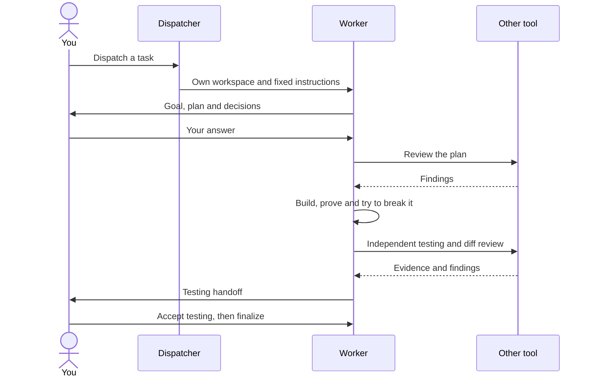

<div align="center">


# Slopmeister

*Plant a task. Let the agents work. Inspect the harvest.*


</div>

Every agent produces a little slop. Slopmeister gives the farm some fences: one set of rules for Claude Code and Codex, one workspace per task, and checks before anything leaves the gate.

Write your instructions once. Slopmeister renders them for both tools, opens each worker in [Orca](https://onorca.dev), and brings the other tool in to review and test its work. You choose the direction and accept the result. Project knowledge stays in a separate Markdown vault.

| Sow | Tend | Harvest |
|---|---|---|
| Give a worker a task, its own branch and a fixed set of instructions. | The worker builds, tests, prunes and receives an independent review. | Read the evidence, accept testing and choose when to finalize. |

## Quick start

The basic tools are **Git, Claude Code, Codex, Orca, 1Password and Tailscale**. Both agent subscriptions and Orca are required. Start on macOS or Ubuntu. Your agent handles the remaining prerequisites through the [onboarding skill](src/skills/workstation/SKILL.md).

### 1. Pick a patch of ground

```bash
git clone https://github.com/Ellebam/slop-meister.git ~/dev/slop-meister
cd ~/dev/slop-meister
```

Use a fork when you intend to publish your own configuration changes. Keep machine facts, customer information and credentials outside the checkout.

### 2. Bring in an agent

Start `claude` or `codex` in this directory and say **“onboard me”**. If needed, invoke `/workstation` or `$workstation` explicitly.

The [workstation skill](src/skills/workstation/SKILL.md) walks through prerequisites, your vault, selected home configuration, logins, Orca and optional services. It explains each change before any missing approval is requested. You complete logins, device pairing and operating-system consent yourself.

The checkout already contains the rendered instructions and skill links. A new session can discover onboarding before Slopmeister is installed into your home directory.

### 3. Open the dispatcher

After onboarding, open this checkout in Orca and run this in its terminal:

```bash
task dispatch -- claude slopmeister-dispatcher
```

Use `codex` instead of `claude` for a Codex dispatcher. The dispatcher waits for your instructions. Ask what work is open, then explicitly name the issue and tool you want dispatched. A successful worker launch reports `plot-session: delivered` with its workspace and evidence.

[Follow a complete session](docs/session-walkthrough.md) from the first task to final acceptance.

## How the farm runs



The **plot** describes a project's rules, task source and permissions. The **field** in your vault holds its knowledge. Workers **sow** a plan, **groom** documentation, **prune** unnecessary work and check whether the result is **ripe**. **Bloom** explains complex work visually, and optional **Grove** hosting lets you read those pages on your phone.

A worker receives a fixed copy of its instructions. Changing the sources affects later sessions. Commit, shipping, publication and stronger actions retain their separate permission boundaries.

## Your project brain

Start with [the example vault](examples/vault/), written entirely as neutral examples. Copy it to a new location outside this checkout, then follow onboarding to initialize its external history before agents edit notes.

The default location is `~/.slopmeister/vault`. It may be a normal directory or a link to another local folder. A plain local vault works without cloud sync. **Google Drive is optional and encouraged** when you want notes and documents on several machines. [Drive access](docs/drive-access.md) covers setup and recovery.

Each project has `fields/<plot>/CONTEXT.md`. That note directs a worker to the right facts. Keep private information there and in private local configuration. [Context and ownership](docs/context-layer.md) explains the boundary and the optional private identifier scanner.

## Add your own plot

Three examples cover the main shapes:

| Example | Shows |
|---|---|
| [example-app](plots/example-app/) | A code project, isolated slots, ports, a [compose example](examples/app/docker/docker-compose.slot.yml) and one project skill |
| [example-client](plots/example-client/) | Injected instructions, selected service actions and denied agent commits, with no access profile shipped |
| [example-notes](plots/example-notes/) | Freeform work and vault tasks |

Follow [project onboarding](docs/context-layer.md#onboard-a-project). The inventory from `task plot -- --list` also includes non-launchable templates, marked `template`.

## Approvals, pages and the phone

Secrets use two tiers on macOS and Ubuntu. Tier one resolves through a local 1Password service account. Tier two needs your instruction for the command and Home Assistant approval. Both tokens stay on each workstation. This is a guardrail for cooperative agents, not isolation from an agent running as your user. Home Assistant and Grove need **Linux**; Grove's pinned binary currently targets x86-64. [Host setup](host/README.md) owns their deployment.

The 1Password desktop integration is the second route. You can order it for an exact command in any session, including when Home Assistant is unavailable. [Secret requests](docs/1password-access.md) explains setup, approvals and limits.

[Phone access](docs/phone-access.md) covers the Claude app and Orca Mobile. Tailscale provides private access to the optional Linux services. Pairing, certificates and real approvals need checks on your own devices.

## Updates and limits

[GitHub releases](https://github.com/Ellebam/slop-meister/releases) identify tested versions. [Release maintenance](docs/releases.md) explains automatic tags and releases.

Updates come by **pulling this repository and reinstalling the selected entries**. Review incoming changes, preserve your optional choices, and follow [Updates](src/skills/workstation/SKILL.md#updates). Existing workers keep their fixed configuration until a normal redispatch.

This project is shared **as it is**, under the [MIT license](LICENSE). It requires your accounts, subscriptions and operator decisions. Static tests do not prove a fresh machine's logins, phone pairing, certificate issuance or real secret approvals. Work through those checks during onboarding.

To change Slopmeister, edit the sources and regenerate `dist/`. [Contributing](CONTRIBUTING.md) and [testing](docs/testing.md) own the development commands. [The documentation index](docs/README.md) points to each mechanism.
