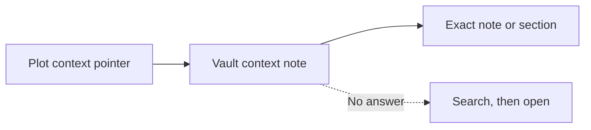

# Find the project's knowledge

A plot tells the worker where to look. The vault holds what it needs to know about the project.

[Overview](../README.md) · [All documentation](README.md) · [Plot composition](plot-shape.md)

## One name, one entry point

A launchable plot uses one name for its declaration, working rules and vault entry point:

| Place | Holds |
|---|---|
| plot.toml in its [plot directory](../plots/) | Task source, optional source history, repository capability, agent commit permission and resources. |
| A directory under [plots/](../plots/) | Working rules and the context pointer. |
| `fields/<name>/CONTEXT.md` in the vault | An index of the project's knowledge. |

The vault folder convention applies to our own projects too. A small project may need only its context note. A larger one uses the vault's field skeleton for its record, conventions, tickets and projects.

The [launcher Git policy](launcher.md#git-in-a-prepared-worktree) owns agent commit and shipping authority.

A plot without a repository omits that section and supplies its vault context and session rules. A freeform plot may also declare a repository without changing its workflow or vault task source. `target.repository.default` names the local checkout for a repo-less area task; a different source repository can still be passed explicitly. `--directory` chooses a Git-free session for any plot, and plots without a default keep that route when no repository is passed. Repository workers and directory sessions both receive the selected vault file grant and shared vault skills, regardless of task source. Slopmeister owns their configuration. The vault owns knowledge and document conventions, routed through `_system/guidelines/README.md`. It receives no rendered configuration. Delivery and workflow mode remain separate, as the [overview](../README.md#how-the-farm-runs) explains.

## Follow pointers before searching

The [code base](../plots/code/plot.md) owns the read-first instruction and search fallback. Each plot's `target.md` names its project, vault home and context path in its last paragraph. Plot policy can precede that pointer. The [inject middle plot](../plots/inject/target.md) passes that point through, adding its vault-ownership rules.

- Plots composed on the inject template also read every note in the vault's `conventions/` folder when it exists. Their [conventions fragment](../plots/inject/conventions.md) owns this and the bloat-report duty.
- Freeform plots compose on the [freeform base](../plots/freeform/plot.md), which owns their discovery instructions and workflow whether the worker uses a repository worktree or a directory.
- Project-specific plot rules may keep task state and implementation outcomes in their tracker, and product documentation in the repository or tracker. The vault holds the operator's own record.
- A repository plot may have its own context index pointing to repository files. It must not copy vault facts. The inject template keeps context in the vault.

The normal route takes two opens, the context index and the note it names. Copying those notes into a summary creates another place for facts to drift. The [renderer tests](../tests/integration/render/test_procedures.py) pin one correct context path per code plot and preserve each template's rules independently of source history.

## Write the context note

Use the [example vault](../examples/vault/) as a starting point, or an existing template owned by your vault. Keep the context note short and use the shape below.

| Part | What to write |
|---|---|
| Opening paragraph | What the project is. |
| Routing table | Six rows in order, listed below. Each names an exact note or retrieval query and says what it answers. Write `none` when nothing applies. |
| Repositories | Location, machine access, how to run and how to test each repository. Give the canonical command or an exact note section. Say when there is no repository. |
| Closing reminder | This is an index. Facts owned by other notes stay in those notes. |

The routing rows are:

1. Stack and environments
2. Services
3. Working rules
4. Open work and current state
5. Decisions
6. History

A folder is not an exact pointer. Empty cells leave the reader guessing. Repository facts are the index's only standalone facts because no other vault note owns them.

## Onboard a project

1. Declare it with `task plot -- --declare <name>`. Supply task source and whether it has a repository, then commit permission when it does. Review the exact TOML and type literal `yes` to write it. No repository argument or origin lookup is used.
2. Add its `target.md` fragment and other required fragments under [plots/](../plots/), following the [plot shape](plot-shape.md).
3. For a repository plot, keep `slots.none = true` when it has no stack, or declare resources in the same TOML file following [slots](slots.md#the-definition).
4. Create `fields/<name>/CONTEXT.md` with the shape above before the first dispatch. Keep repository facts in the repository and route to them from the note.
5. For a customer, add an owning note for accounts, access routes and open questions under the vault's documentation conventions. Credentials stay in the password manager.
6. Add the field's row to the vault's field index at `fields/_INDEX.md`.
7. When the field has its own task list, create `To-Do/<name>.md` with a `## Active` and a `## Done` section and add its row to `To-Do/README.md`. The file name is the key the `vault-todos` helper accepts, and no code changes.
8. Run `task materialize` and `task check`, then commit the Slopmeister configuration through the normal workflow.

The [launcher procedure](../src/skills/plot-session/SKILL.md) covers the first launch. New tickets and projects inside a plot's area use its vault skeleton and current context.

## Private identifier patterns

`bin/slopmeister quality` can reject local private identifiers before they enter a commit. Keep the patterns outside the repository in an owner-only regular file. The file must belong to the current user, be readable by that user and grant no group or other access. A symlink or a file inside the repository is refused.

Set `SLOPMEISTER_PRIVATE_PATTERNS` to select the file. Without that variable, the checker uses `~/.config/slopmeister/private-patterns` when present. If the variable is unset and the default file is absent, identifier scanning is optional and returns no findings. An explicitly selected missing, unreadable, unsafe or invalid file fails the quality check. An empty variable selects the default path but still requires it to be valid.

Write one regular expression per line. Matching is case-insensitive. Blank lines and lines beginning with `#` are ignored. An empty file or one containing only comments selects no patterns. Keep actual names and patterns out of repository files, tests and shared logs.

The checker scans path names and working-tree contents of tracked and non-ignored untracked files. It reads UTF-8 and BOM-marked UTF-16 text, including hidden files, and matches readable bytes in binary files. It does not unpack archives or images. It reports the file and line, never the matched text, and no allowlist entry can waive a finding. A matching path is reported by its position in the sorted listing with the command that locates it, never by the path itself. Identifier findings stop the check before other diagnostics can echo private paths or symbols. For symlinks it checks link text, not destination contents. It does not scan Git history. Declaring a plot does not extend the patterns. Inspect proposed changes for private facts even when lint passes, and keep those facts in the vault.

## Offboard a project

1. Revoke the upstream access token unless another plot still uses it. Agree shared-token revocation with the operator first.
2. Revoke the secret-store service-account token upstream unless another plot still uses it.
3. Remove the profile directory under `~/.config/slopmeister/access/<plot>/`. Remove the protected token file at the profile's absolute `token_file` path unless another profile still uses it.
4. Remove worktrees that hold delivered action copies. Removing a plot does not revoke existing snapshots.
5. Delete or hand back clones as the ownership contract requires.
6. Remove the plot declaration and its roster row.
7. Move the vault field to the archive and repair its entry links.
