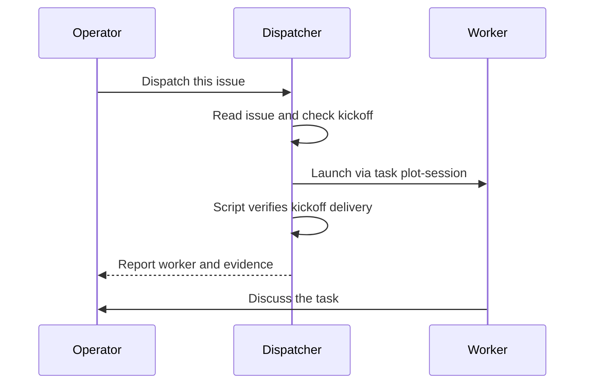
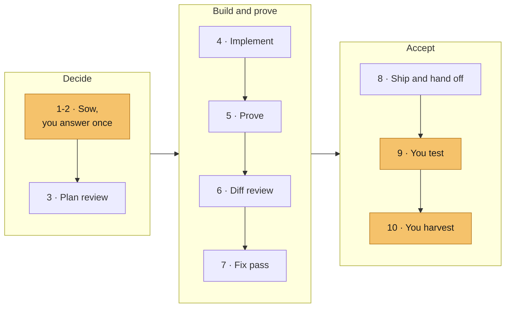

# One session, start to finish

Follow one issue from the dispatcher's tab to a merged pull request. You decide, a worker does the work, and the other tool reviews and tests it.

[Overview](../README.md) · [All documentation](README.md) · [Skills](skills.md)

## Contents

- [Prepare and dispatch](#prepare-and-dispatch)
- [What the worker receives](#what-the-worker-receives)
- [The ten steps](#the-ten-steps)
- [Pause and resume](#pause-and-resume)
- [What remains afterwards](#what-remains-afterwards)

## Prepare and dispatch

On a new macOS or Ubuntu workstation, follow the [quick start](../README.md#quick-start) first. On a prepared machine, run these from the Slopmeister checkout:

```bash
task check
task dispatch -- claude slopmeister-dispatcher
```

The dispatcher is the one standing agent. Ask it what's open and it reads the backlog. Tell it to dispatch an issue and it writes a kickoff starting with `Mode: spine`, checks it and launches the worker. Under the hood it runs these, with a plot-first name such as `slopmeister-120-session-names`:

```bash
task kickoff:check -- - < kickoff.md
task plot-session -- <slopmeister root> slopmeister <name> --issue-id <number> --tool claude < kickoff.md
```

A good brief prints `kickoff adheres: ...`. [Task briefs](contracts.md) says what belongs in one.

The Slopmeister example above has no slot resources. Other plots follow [Choose the worker command](../src/skills/plot-session/dispatcher.md#choose-the-worker-command).



The worker opens in its own Orca terminal and worktree. The launcher prints `plot-session: delivered` with the workspace, session ID and evidence path, then marks the issue `agent:claimed`. [Issue ownership](issue-claims.md) covers claims, and the [launcher procedure](../src/skills/plot-session/SKILL.md) covers options and recovery.

> [!NOTE]
> A running process doesn't prove delivery. The launcher reports success only when it finds the kickoff in the session's own record. If it reports failure, look at the worker's terminal, often a trust prompt is waiting, before you retry.

## What the worker receives

| Input | Claude Code | Codex |
|---|---|---|
| Global rules | Installed `~/.claude/CLAUDE.md` | Installed `~/.codex/AGENTS.md` |
| Slopmeister agreement | Fixed `CLAUDE.md` copy | Fixed root `AGENTS.md` copy |
| Procedures | Fixed `.claude/skills/` copies | Fixed `.agents/skills/` copies |
| Task | The kickoff, as the opening message | The kickoff, as the opening message |

The agreement sends the worker to `fields/slopmeister/CONTEXT.md` in the vault first, see [context and ownership](context-layer.md). The copies stay fixed for the whole session, even when Slopmeister changes meanwhile. [The launcher](launcher.md) explains what else a workspace gets and which Git actions need your approval.

The worker keeps its decisions and evidence in an untracked `<TASK-ID>-NOTES.md` in its worktree.

## The ten steps

One ticket, one branch, one worker, one conversation. The worker runs every step itself and stops wherever you decide.



| # | Step | The worker | You |
|---|---|---|---|
| 1-2 | [sow](../src/skills/sow/SKILL.md) | Names the user result, checks existing tools and consumers, scopes the smallest useful change and sends one message with real forks, paid checks and explicit remote consent. | Answer once. |
| 3 | [plan review](../src/skills/cross-tool-review/SKILL.md) | Has the other tool review the plan, checks each finding, runs `prune` and applies what survives. | |
| 4 | [implement](../src/skills/implement/SKILL.md) | Builds test-first inside the scope. | |
| 5 | [prove](../src/skills/local-qa/SKILL.md), then the automatic path | Uses the change, proves distinct behaviors and boundaries, tries counterexamples and runs `task check`. Then makes the snapshot where allowed, writes the guide, freezes a candidate when commits are denied, runs the independent tester, handles regressions and ships where allowed. | |
| 6 | [diff review](../src/skills/cross-tool-review/SKILL.md) | Has the other tool review the proved and independently tested diff. | |
| 7 | [fix pass](../src/skills/implement/SKILL.md) | Makes only the fixes that survived `prune` and proves them again. | |
| 8 | [hand off](../src/skills/execute-plan/SKILL.md) | Ships the fixed branch where allowed and reports with the existing guide. | |
| 9 | testing | | Accept the tester's verdict and run any checks the guide leaves to you. |
| 10 | [harvest](../src/skills/harvest/SKILL.md) | | Explicitly invoke `/harvest` or `$harvest`. Finalize remains a completed-task compatibility entry. |

After your one answer, the worker goes straight through to the report on its own, following [execute-plan](../src/skills/execute-plan/SKILL.md). The report lists every review and tester finding in one line, applied or dropped with the reason, and you can reopen any of them. The worker halts earlier only for a security must-fix, a wrong approach, drift from the ticket, a fix outside the scope, a second tester failure or an error it cannot diagnose. The tester runs against the exact commit and returns pass, fail or blocked with quoted evidence, and the worker never regrades it.

Permanent tests follow the shared [test-purpose rule](../src/skills/implement/SKILL.md#test-purpose). Before another round, the worker separates required product failures, broken setup or guides, real additional defects and unsupported probes. The tester executes required scenarios independently. Added candidates do not change its verdict. Promoted tests after a pass need affected proof, not another confirmation tester.

**Reviews run once.** Each review keeps one result per task and mode, and asking again replays it. A fresh result needs your explicit word, then the worker runs `review replace --mode <plan|diff>`. A finding that says the approach is wrong comes to you, and you either ship with a follow-up issue or abandon and re-ticket.

Plots that require [groom](../src/skills/groom/SKILL.md) use it for affected repository docs and vault notes. Plans name the documents and actions. Maintenance finishes before proof, and both reviews check it. Freeform records the list in session notes.

**Harvest is yours.** Green CI or an open PR cannot authorize it. Explicit `/harvest` or `$harvest` selects an ending based on the saved state. Finished spine work retains testing acceptance and merge/integration gates. Unfinished work can ship an open PR and hand back its issue after guarded shutdown. Unsaved or unpushed work keeps the workspace. Direct harvest can repair routine document gaps through groom. Finalize retains its verification-only document pre-flight and completed-task alternatives. Close-out remains a separate narrow report and legacy-retro route.

## Pause and resume

Stopping at a gate or running out of context is a pause. The notes file stays, and the worker leaves a handoff with open questions and the commands for anything still running. Nothing is closed.

When a worker must be replaced, first have it confirm its state is saved, then relaunch with the same name:

```bash
task plot-session -- <slopmeister root> slopmeister slopmeister-120-session-names --redispatch --tool claude < kickoff.md
```

The launcher verifies the saved workspace and required native-tool startup before it stops the old worker and starts a fresh conversation in the same workspace, with the same fixed configuration. The new worker reads Git, the notes file and the tester and review paths recorded there, then resumes at the first unfinished step without rerunning proof or reviews. After a crash, only what's on disk survives.

## What remains afterwards

| Kept | Removed by successful harvest cleanup |
|---|---|
| Pull request, issue and comment in the state the ending permits | Task notes, only after proof and recovery records are retained |
| Session retro under `_system/retros/`, with legacy logs retained | Task worktree; the local branch stays |
| Review results under the repository's Git directory, `slopmeister-config/reviews/` | |
| Tester runs under `~/.local/state/slopmeister/spine-tests/` | |
| Claude transcript or Codex rollout | |
| Kickoff files under Slopmeister's `tmp/plot-session/`, until a later launch removes them | |

[Browse the skills](skills.md) or [read the agreement the worker followed](../dist/codex/plots/slopmeister.md).
