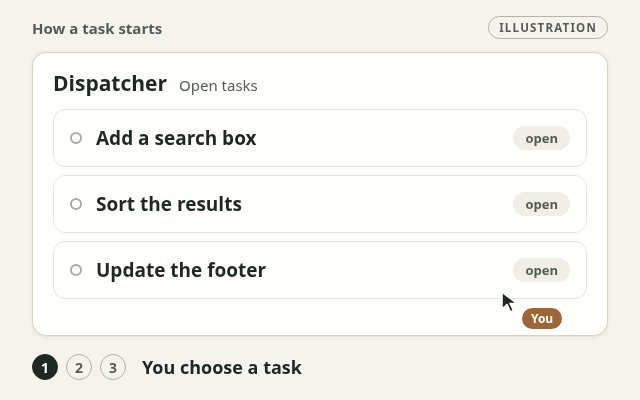
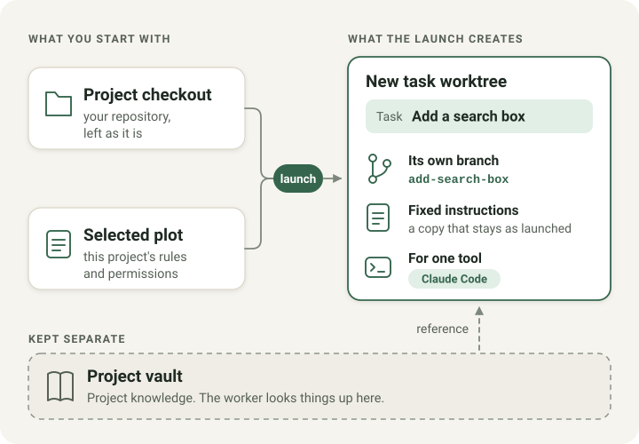
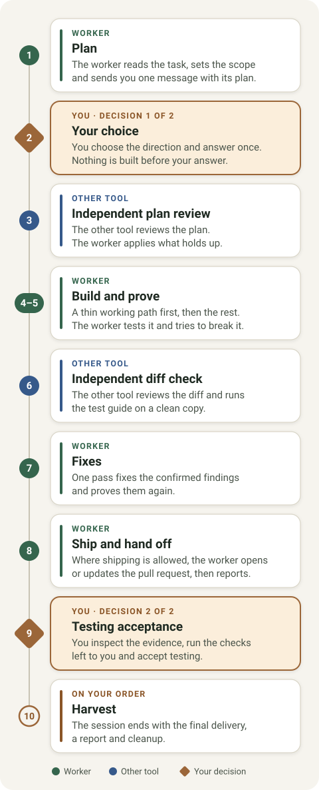
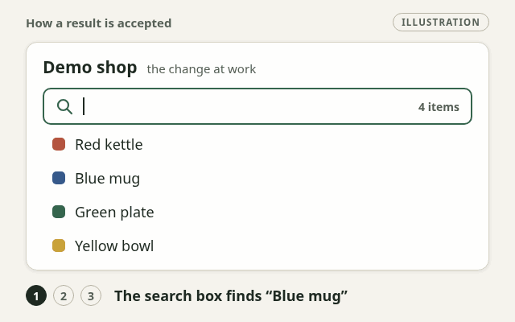

# One session, start to finish

Suppose a shop lists four products. You want a search box that filters the list as you type. Follow that task from your first instruction to a tested change and a decision about merging.

[Overview](../README.md) · [All documentation](README.md) · [Skills](skills.md)

## Contents

- [Prepare and dispatch](#prepare-and-dispatch)
- [What the worker receives](#what-the-worker-receives)
- [The ten steps](#the-ten-steps)
- [Pause and resume](#pause-and-resume)
- [What remains afterwards](#what-remains-afterwards)

## Prepare and dispatch

On a new macOS or Ubuntu workstation, follow the [quick start](../README.md#quick-start) first. On a prepared machine, run these from the Slopmeister checkout:

```bash
task check
task dispatch -- claude slopmeister-dispatcher
```

Tell the dispatcher which issue to start and which tool should own it. For the shop, the instruction might be “Dispatch the search-box issue to Claude.” The dispatcher reads the issue, checks its [task brief](contracts.md) and launches a worker. The first message from that worker should tell you what it plans to deliver.

[](../assets/launch-animation.gif)

The worker opens in its own Orca terminal and worktree. The launcher prints `plot-session: delivered` with the workspace, session ID and evidence path, then marks the issue `agent:claimed`. [Issue ownership](issue-claims.md) covers claims, and the [launcher procedure](../src/skills/plot-session/SKILL.md) covers options and recovery.

> [!NOTE]
> A running process doesn't prove delivery. The launcher reports success only when it finds the kickoff in the session's own record. If it reports failure, look at the worker's terminal, often a trust prompt is waiting, before you retry.

## What the worker receives

The task gets a branch, a worktree and a fixed copy of the plot instructions. The worker can edit the search box there while another worker works on a different branch.

[](../assets/plot-session.svg)

| Input | Claude Code | Codex |
|---|---|---|
| Global rules | Installed `~/.claude/CLAUDE.md` | Installed `~/.codex/AGENTS.md` |
| Slopmeister agreement | Fixed `CLAUDE.md` copy | Fixed root `AGENTS.md` copy |
| Procedures | Fixed `.claude/skills/` copies | Fixed `.agents/skills/` copies |
| Task | The kickoff, as the opening message | The kickoff, as the opening message |

The agreement sends the worker to `fields/slopmeister/CONTEXT.md` in the vault first, see [context and ownership](context-layer.md). The copies stay fixed for the whole session, even when Slopmeister changes meanwhile. [The launcher](launcher.md) explains what else a workspace gets and which Git actions need your approval.

The worker keeps its decisions and evidence in an untracked `<TASK-ID>-NOTES.md` in its worktree.

## The ten steps

One ticket, one worker, one conversation, with the same task branch name in every needed repository. The worker runs every step itself and stops wherever you decide.

For the shop, the smallest working change lets a reader type “blue” and see “Blue mug.” The worker tries it before adding the rest, then checks cases such as an empty search or a query with no match. The other tool tests the result on a clean copy and records what it saw.

[](../assets/spine.svg)

| # | Step | The worker | You |
|---|---|---|---|
| 1-2 | [sow](../src/skills/sow/SKILL.md) | Names the user result, checks existing tools and consumers, scopes the smallest useful change and sends one message with real forks, paid checks and explicit remote consent. | Answer once. |
| 3 | [plan review](../src/skills/cross-tool-review/SKILL.md) | Has the other tool review the plan, checks each finding, runs `prune` and applies what survives. | |
| 4 | [implement](../src/skills/implement/SKILL.md) | Builds test-first inside the scope. | |
| 5 | [prove](../src/skills/local-qa/SKILL.md), then the automatic path | Uses the change, proves distinct behaviors and boundaries, tries counterexamples and runs `task check`. Then makes the snapshot where allowed, writes the guide, freezes a candidate when commits are denied, prepares the independent check and ships where allowed. | |
| 6 | [diff review](../src/skills/cross-tool-review/SKILL.md) | Has the other tool review the diff and run the guide against a clean copy. | |
| 7 | [fix pass](../src/skills/implement/SKILL.md) | Makes only the fixes that survived `prune` and proves them again. | |
| 8 | [hand off](../src/skills/execute-plan/SKILL.md) | Ships the fixed branch where allowed and reports with the existing guide. | |
| 9 | testing | | Accept the diff check’s scenario results and run any checks the guide leaves to you. |
| 10 | [harvest](../src/skills/harvest/SKILL.md) | | Order the end in any words, or type `/harvest` or `$harvest`. |

After the plan decision, you receive a handoff with the evidence, confirmed fixes and any checks that need your device. Read the observed result. If the search finds the wrong product, send it back. When the result works for you, accept testing. You decide when the session should merge and finish.

[](../assets/proof-acceptance-animation.gif)

The illustrations have editable HTML sources for [launch](../assets/launch-animation.html) and [testing](../assets/proof-acceptance-animation.html). To record a variant, open the source at 640 × 400 in a browser with `#capture` on its address. Capture the stage after calling `window.__seek(t)` at 100 ms intervals from zero to `window.__duration`. Keep the time spent on identical frames when encoding the loop.

[Independent testing](testing.md#the-independent-check-and-readable-handoff) explains how the checks run. The [harvest procedure](../src/skills/harvest/SKILL.md) describes what happens when work is complete or you need to stop early.

## Pause and resume

Stopping at a gate or running out of context is a pause. The notes file stays, and the worker leaves a handoff with open questions and the commands for anything still running. Nothing is closed.

When a worker must be replaced, first have it confirm its state is saved, then relaunch with the same name:

```bash
task plot-session -- <slopmeister root> slopmeister slopmeister-120-session-names --redispatch --tool claude < kickoff.md
```

The launcher verifies the saved workspace and required native-tool startup before it stops the old worker and starts a fresh conversation in the same workspace, with the same fixed configuration. The new worker reads Git, the notes file and the review and evidence paths recorded there, then resumes at the first unfinished step without rerunning proof or reviews. After a crash, only what's on disk survives.

## What remains afterwards

| Kept | Removed by successful harvest cleanup |
|---|---|
| Pull request, issue and comment in the state the ending permits | Task notes, only after proof and recovery records are retained |
| Existing proof and recovery records retained outside the worktree | Task worktree. The local branch stays. |
| Review results under the repository's Git directory, `slopmeister-config/reviews/` | |
| Tester runs under `~/.local/state/slopmeister/spine-tests/` | |
| Claude transcript or Codex rollout | |
| Kickoff files under Slopmeister's `tmp/plot-session/`, until a later launch removes them | |

[Browse the skills](skills.md) or [read the agreement the worker followed](../dist/codex/plots/slopmeister.md).

## Follow-up work on a task branch

An unchanged follow-up can reuse its original plan approval and completed review only after checking the original evidence. If the plan changes, get the plan answer and review. The [ship procedure](../src/skills/ship/SKILL.md) permits a new pull request after the previous one merged when new commits descend from its head. The new body names exactly the latest predecessor. Retry does not repeat confirmed writes. A closed unmerged or ambiguous request remains a refusal.
